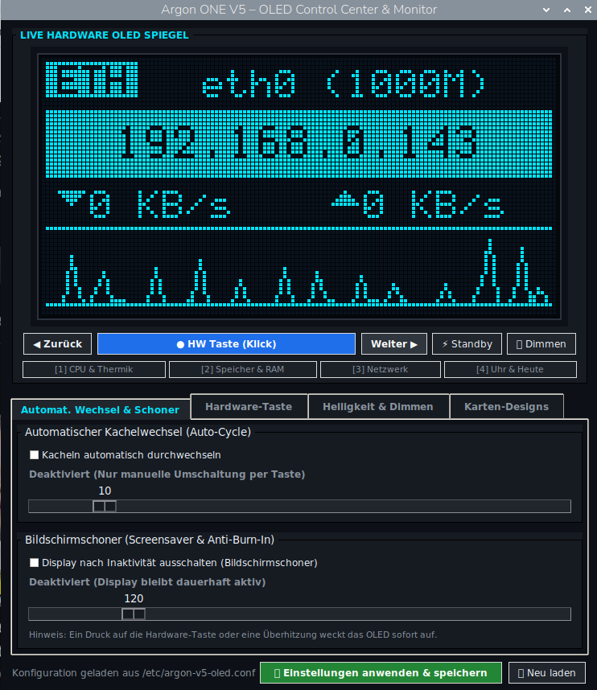
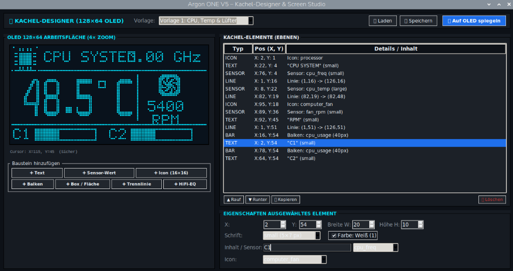

# Argon ONE V5 OLED Display Suite (Alpha)

[](#-aktuelle-einschr%C3%A4nkungen--wip-status)
[](https://www.raspberrypi.com/)
[](https://www.argon40.com/)
[](LICENSE)

> [!WARNING]
> ### ⚠️ EXPERIMENTELL / WORK IN PROGRESS (ALPHA)
> **Wichtiger Hinweis:** Dieses Projekt befindet sich in einem **frühen Entwicklungsstadium** und funktioniert derzeit **nur rudimentär**!  
> Viele Funktionen, Layouts und Schnittstellen werden aktiv überarbeitet und sind **noch nicht für den produktiven Produktiveinsatz** vorgesehen.
> 
> *Notice: This project is in active development (Alpha / WIP) and only rudimentarily functional. Not yet intended for production environments.*

---

## 📖 Projektübersicht

Die **Argon ONE V5 OLED Suite** ist ein leichtgewichtiger Treiber, Monitor- und Designer-Werkzeugsatz für das integrierte 128×64 I2C SSD1306 OLED-Display und die Hardware-Taste am **Argon ONE V5 Gehäuse** für den Raspberry Pi 5.

Das Projekt besteht aus vier Kernkomponenten:

```
argon-v5-oled/
├── src/                  (C-Daemon: SSD1306 I2C-Treiber, Hardware-Taste, Sensoren)
├── argon-oled            (C-CLI: Steuerbefehle für Terminal und Skripte)
├── argon_hw_discovery.py (Python: Hardware & Sensor Discovery Engine)
├── argon-oled-desktop    (Python/Tkinter: Desktop Control Center mit Live-OLED-Spiegel)
└── argon_card_builder.py (Python/Tkinter: Visueller Kachel-Designer mit SVG/XBM-Konverter)
```

---

## 🛠️ Komponenten im Detail

### 1. C-Daemon (`argon-v5-oled`)
* **Extrem ressourcenschonend:** In reinem C geschrieben, benötigt weniger als 0.1 % CPU-Last und ~2 MB RAM.
* **I2C-Kommunikation:** Direkte Ansteuerung des SSD1306 Controllers auf Bus 1 (`0x3c`).
* **Hardware-Tasten-Integration:** Unterstützt Einfachklick (Kachelwechsel), Doppelklick, Halten (Dimmen/Standby) über `libgpiod`.
* **Vordefinierte Kachel-Ansichten:**
  * **CPU & Thermik:** Taktfrequenz, Temperatur, Lüfter-Drehzahl (RPM) und Core-Balken.
  * **Speicher & Drives:** NVMe, RAM und USB mit Belegungsbalken und 7-Band HiFi-Equalizer für I/O-Last.
  * **Netzwerk:** IP-Banner, Up/Down Traffic-Meter und Sparkline-Welle.
  * **Clock & Today:** Hero-Digitaluhr mit Uptime und Datumsanzeige.

### 2. Kommandozeilen-Tool (`argon-oled`)
Schnelle Steuerung aus dem Terminal oder für Tastaturkürzel:
```bash
argon-oled sensors    # Scannt alle Hardware-Sensoren (Thermik, PMIC, GPU, RAID, USB)
argon-oled sensors --json # Maschinenlesbare JSON-Ausgabe
argon-oled next       # Nächste Kachel
argon-oled prev       # Vorherige Kachel
argon-oled screen 1   # Direkt zu Kachel 1 springen
argon-oled toggle     # Display an- / ausschalten
argon-oled dim        # Display dimmen
argon-oled status     # Status ausgeben
```

### 3. Desktop Control Center (`argon-oled-desktop`)
* Grafisches Control Center (Tkinter) mit pixelgenauem Live-Spiegel des OLED-Displays über `/dev/shm/argon_oled_fb.bin`.
* Konfiguration von automatischem Kachelwechsel, Bildschirmschoner-Zeiten, Tastenaktionen und Kachel-Varianten.

<p align="center">
  
</p>

### 4. Visueller Kachel-Designer & Screen Studio (`argon_card_builder.py`)
* 128×64 Arbeitsfläche mit 4× Vergrößerung und 1px-Sicherheitsrand-Überwachung.
* **Eingebauter 1-Bit Konverter:** Importiert SVG-, XBM- und Bilddateien, skaliert sie wahlweise auf 16×16 oder 24×24 und exportiert Standard-XBMs.
* **Portabler Kachel-Bundler:** Speichert Designs als `.argoncard`-Paket (ZIP) inklusive aller verwendeten Grafiken.
* **Live-Spiegelung:** Überträgt den aktuellen Entwurf per Knopfdruck sofort auf das echte OLED-Display.

<p align="center">
  
</p>

---

## ⚠️ Aktuelle Einschränkungen & WIP-Status

* **Dynamische Kacheln im C-Daemon:** Der C-Daemon nutzt derzeit noch fest einprogrammierte Kachel-Routinen. Der JSON-Interpreter, um selbsterstellte `.argoncard`-Dateien nativ im Daemon abzurufen, befindet sich in der Entwicklung.
* **Sensor-Tuning:** Manche Telemetriewerte (wie detaillierte NVMe-Lasten) erfordern noch experimentelle Berechtigungen oder sysfs-Pfade.
* **Systemd-Service:** Der automatische Startdienst muss auf manchen Systemen manuell per `systemctl enable` nachjustiert werden.

---

## 🔨 Kompilieren & Installieren

### Abhängigkeiten installieren (Debian / Raspberry Pi OS):
```bash
sudo apt update
sudo apt install -y build-essential libgpiod-dev libgpiod3 i2c-tools python3 python3-tk python3-pil
```

### Bauen:
```bash
cd argon-v5-oled
make
```

### Installieren:
```bash
sudo make install
sudo systemctl daemon-reload
sudo systemctl enable --now argon-v5-oled.service
```

---

## 📄 Lizenz

Dieses Projekt ist unter der [MIT Lizenz](LICENSE) lizenziert.  
Die Software wird „wie besehen“ (AS IS) ohne jegliche Gewährleistung zur Verfügung gestellt.
